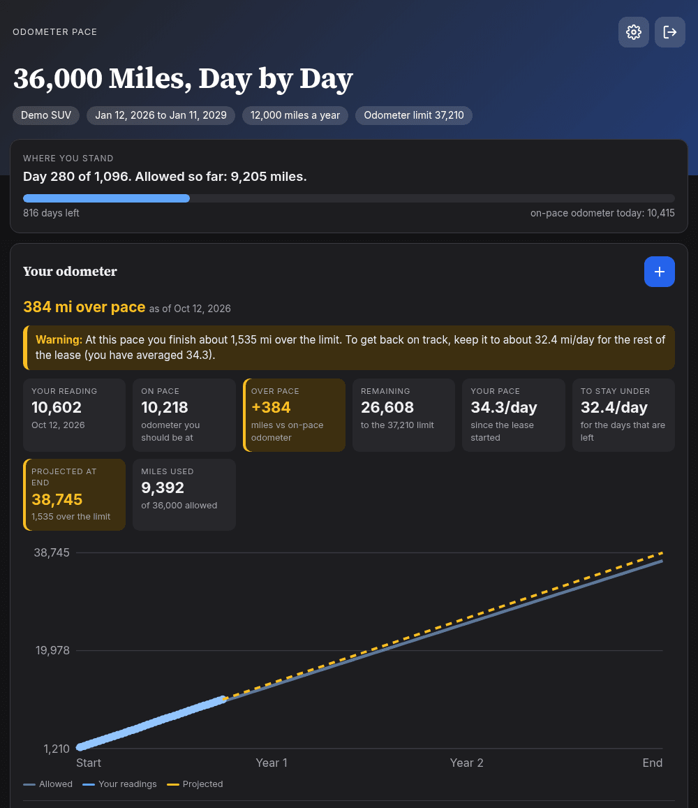
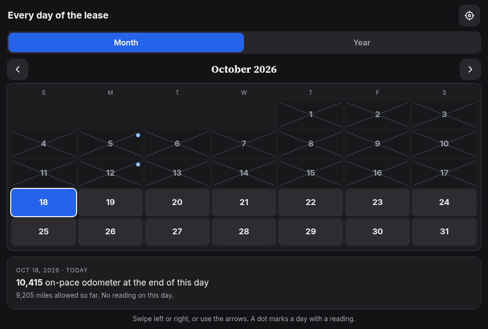

# Odometer Pace


[](https://github.com/dhrandy/odometer-pace/actions/workflows/test.yml)


A small self-hosted page that tracks a car lease's mileage. It shows every day of the lease as a calendar, crosses off the days that have passed, and compares your odometer with where it should be. Readings are saved on your server, so your phone and your computer always match.

<p>
  
</p>
<p>
  
</p>

The screenshots use an invented lease ("Demo SUV") and made-up readings.

> **Beta.** Expect rough edges while it is still being tested.

- Day-by-day calendar for the whole lease, today marked, past days crossed off
- Odometer log: over or under pace, miles remaining, miles per day, projected odometer at lease end
- Chart of your readings against the allowed line
- One container, one small JSON file in a volume, no database server
- Dark theme with six accent colors (purple by default) and an OLED black option, set in Settings, works on phones
- Admin and user logins: the admin sets up the lease, everyone else can add readings
- API keys so an AI or script can add readings and read your status, one set per person
- Your lease details are typed in the app on first run. Nothing about your lease is in the code.

## Setup

1. Copy `docker-compose.yml` into a new stack (Dockhand, Portainer, plain Docker, anything that reads Compose files).
2. Fill in the variables. Either put them in a `.env` file next to the compose file, or paste them in Dockhand's Environment tab. Do not add `:-` defaults, some tools choke on them.
3. Start the stack.
4. Open `http://your-server:8461`. The first screen creates the admin login (a username and a password).
5. Enter your lease: start date, number of years, total miles allowed, and the odometer reading on the day you got the car.

### Variables

| Variable | What to put | Example |
| --- | --- | --- |
| `PORT` | Port to listen on (host and container use the same number) | `8461` |
| `TZ` | Your time zone, so "today" is right | `America/New_York` |
| `AUTH_MODE` | `app` for the built-in login, `proxy` if your reverse proxy handles login | `app` |
| `COOKIE_SECURE` | `true` when you reach it over https, `false` on plain http | `true` |
| `TRUST_PROXY` | `1` when it sits behind a reverse proxy, otherwise `0` | `1` |
| `DATA_PATH` | Folder on your server where readings are stored | `/DATA/AppData/odometer-pace` |

A filled-out example is in `.env.example`.

### Compose file

```yaml
services:
  odometer-pace:
    container_name: odometer-pace
    build: https://github.com/dhrandy/odometer-pace.git#main
    restart: unless-stopped
    ports:
      - "${PORT}:${PORT}"
    environment:
      PORT: ${PORT}
      TZ: ${TZ}
      AUTH_MODE: ${AUTH_MODE}
      COOKIE_SECURE: ${COOKIE_SECURE}
      TRUST_PROXY: ${TRUST_PROXY}
    volumes:
      - ${DATA_PATH}:/data
    read_only: true
    tmpfs:
      - /tmp
    cap_drop:
      - ALL
    cap_add:
      - CHOWN
      - SETUID
      - SETGID
    security_opt:
      - no-new-privileges:true
    healthcheck:
      test: ["CMD-SHELL", "wget -qO- http://127.0.0.1:$${PORT}/api/session >/dev/null || exit 1"]
      interval: 30s
      timeout: 5s
      retries: 3
      start_period: 10s
```

The container builds from this repository, so the Dockerfile is only used by the build and you never run it yourself. To update: stop, rebuild or pull, start. Your readings live in `DATA_PATH` and are kept.

## Reverse proxy

Any reverse proxy works: point it at the container port and turn on https. The app has its own password login (`AUTH_MODE=app`), so the proxy does not need one. Set `COOKIE_SECURE=true` and `TRUST_PROXY=1` when you use https behind a proxy.

If you would rather put your own login in front (Authentik, Authelia and similar), set `AUTH_MODE=proxy`. The app then trusts everything that reaches it, so make sure the page can only be reached through the login. Keep `/api/v1/` open past that login: those routes are protected by API keys instead, which is how an AI or script gets in.

The app sends `noindex` headers and a `robots.txt` that disallows everything. Your server settings, readings and keys are never reachable without logging in.

## Running a second copy for another car

The app tracks one vehicle. For another car, run a second copy as its own stack. Nothing is shared between copies.

1. Paste the compose file again as a new stack, and change the service name and `container_name` to something unique, for example `odometer-pace-2`.
2. Use a different `PORT` (for example `8462`) and a different `DATA_PATH` (for example `/DATA/AppData/odometer-pace-2`).
3. Open the new port. It starts empty, so you create its own admin login and enter that car's lease.
4. Give the second copy its own address in your reverse proxy, and its own API keys.

## Admin and users

The first login you create is the admin. The admin adds logins for the rest of the household in Settings, under Logins.

| | Admin | User |
| --- | --- | --- |
| See the calendar, stats and chart | yes | yes |
| Add odometer readings | yes | yes |
| Delete readings | yes | no |
| Change lease settings | yes | no |
| Pick own accent color and OLED black | yes | yes |
| Add, remove and reset logins | yes | no |
| Create and revoke their own API keys | yes | yes |
| See and revoke everyone's API keys | yes | no |
| Change their own password | yes | yes |

Each reading shows who entered it. Removing a user also removes their API keys. The admin login itself cannot be removed, and there is no password reset by email, so the admin sets a new password for a user from Settings. If the admin forgets their own password, stop the container, delete the `users` list from `odometer-pace.json` in your data folder, and start it again to create a new admin.

With `AUTH_MODE=proxy` there are no logins in the app. Everyone who gets through your proxy counts as the admin.

## API keys for AI and scripts

Everyone with a login (admin or user) can open Settings, then API keys, give a key a name and create it. The key is shown once, so copy it then. Only a hash is stored. A key belongs to the person who made it, and the admin can see and revoke all keys.

**Hand the key to your AI securely.** Give it through a vault, a secrets manager or an environment variable, never by pasting it into a chat or a prompt. Anything typed into a chat can be stored in its history. If a key ends up somewhere it should not be, revoke it in Settings and make a new one.

A key can add odometer readings and read the status and readings. It cannot see settings, logins, or other keys. The full docs, with examples, are at `/api/docs` after you log in.

```
curl -H "Authorization: Bearer $KEY" https://your-host/api/v1/status

curl -X POST https://your-host/api/v1/readings \
  -H "Authorization: Bearer $KEY" -H "Content-Type: application/json" \
  -d '{"odometer": 1150, "date": "2030-04-05"}'
```

`date` is optional and defaults to today. One reading per date, and the odometer cannot go lower than an earlier reading. A second reading for a date that already has one replaces it, and the reply says so with `"replaced": true` and the old value in `previous`. In the web app, saving over an existing date asks you to confirm first.

### Instructions to give your AI assistant

Paste this into your assistant's instructions or memory. Replace YOUR-HOST with your address. Do not paste the API key into the instructions or into a chat. Put it in your assistant's secret store, vault or environment variables under the name `ODOMETER_PACE_KEY`, so it can read the key when it makes a call.

````
You can keep my car lease mileage up to date through a small API called Odometer Pace.

Base URL: https://YOUR-HOST

The API key is stored in your secret store, vault or environment as ODOMETER_PACE_KEY. Read it from there each time you make a call. Never ask me for it in chat. If you cannot find it, tell me it is missing and stop.

Send the key on every request as a header:
Authorization: Bearer <the value of ODOMETER_PACE_KEY>
For POST requests also send: Content-Type: application/json

What you can do:

1. Check where I stand: GET /api/v1/status
   Useful fields in the reply:
   - latest.odometer and latest.date: the last reading on file
   - latest.pace_status: "over", "under" or "on_pace"
   - latest.miles_over_pace: positive means over pace, negative means under
   - latest.miles_remaining: miles left before the limit
   - latest.miles_per_day_to_stay_under: what I can drive per day from now on
   - latest.projected_end_odometer and latest.projected_vs_limit: where I end up at this pace
   - allowed_odometer_today: the on-pace odometer for today
   - warning.level ("none", "watch", "warning", "urgent") and warning.message: if the level is not "none", tell me the message. warning.stale_note says the last reading is old; remind me to send a new one
   - lease.state: "not_started", "active" or "complete"
   If latest is null, there are no readings yet. If configured is false, the lease is not set up and I need to do that in the app.

2. List readings: GET /api/v1/readings
   Returns {"readings": [{"date", "odometer", "source"}]}, oldest first.

3. Add a reading: POST /api/v1/readings
   Body: {"odometer": 12345}
   Or with a date: {"odometer": 12345, "date": "2030-04-05"}
   The date is optional (YYYY-MM-DD) and defaults to today. Only one reading is kept per date, so a second one for the same date replaces the first.
   Success is HTTP 200 with {"saved": {...}, "replaced": true or false, "previous": {"odometer": N} or null, "status": {...}}, and the status is the same shape as GET /api/v1/status. If replaced is true, you overwrote an earlier reading for that date: tell me the old and new numbers.
   A rejected reading is HTTP 400 with {"error": "plain reason"}, for example if the odometer is lower than an earlier reading or the date is before the lease starts. Tell me the reason. Do not retry with a changed number to get around it.
   HTTP 401 means the key is wrong or revoked. HTTP 429 means too many failed attempts, so wait and tell me.

Rules:
- Never print, repeat, log or save the API key, and never put it in a message to me or anyone else. Only use it in the Authorization header.
- Only add a reading when I give you the odometer number or you read it from a photo or screen I showed you. Never guess, estimate or calculate one.
- Odometer readings are whole miles. If I say "about 12.3k", ask me for the exact number.
- Before adding, tell me the number and date you are about to save if there is any doubt. After adding, tell me the new pace in one or two sentences: miles over or under pace, and how many miles I have left.
- You cannot delete readings or change settings. If something needs fixing, tell me to do it in the app.
````

## Icons

Buttons for settings, log out, back, delete, revoke and jump to today are icons, drawn inline in the page (nothing is loaded from elsewhere). Each has a text label for screen readers and a hover tooltip, and is at least 44 px square. Actions that need a word, like Save reading, keep their text.

## Warnings

When you are over pace, a banner appears above the numbers with a plain sentence about what it means, for example "At this pace you finish about 600 mi over the limit. To get back on track, keep it to about 28 mi/day for the rest of the lease." There are three levels, each starting with a word so it never relies on color alone:

- **Watch**: over pace, but the projection still ends under the limit.
- **Warning**: projected to finish over the limit.
- **Urgent**: projected overage above 10% of the lease, already past the limit, or the miles per day left to stay under are less than half the normal rate.

Nothing shows when you are on or under pace. The level comes from your latest reading and the overall projection, so weekly readings work as well as daily ones. If the last reading is more than 10 days old, a quiet note says so. The same information is in `/api/v1/status` as a `warning` object, so an assistant can tell you. The app sends no emails or push notifications.

## Optional features

Settings has an **Optional features** card. Everything in it is off until the admin turns it on.

- **Overage cost**: set the dollars per mile your lease charges over the limit. Shows the projected fee at turn-in next to the projection.
- **Trip what-if**: type the miles of a planned trip to see how it changes the projected end odometer, the fee and the miles per day to stay under. The trip is added on top of what you already drive.
- **Glance view**: a card at the top with the miles you can drive this week and by the end of today and still be on pace, colored amber when over and blue when on track. It also turns on `GET /api/v1/glance`, a small read-only endpoint for widgets.
- **Export and backup**: download readings as CSV, or a JSON backup of lease settings and readings. Restore from a backup file in the same card. Backups never contain logins or API keys.

### Home Assistant sensor

Create an API key in Settings, turn on the glance view, then add this to your Home Assistant `configuration.yaml`. Put the key in `secrets.yaml` as `odometer_pace_auth: "Bearer op_..."` and replace the address with your own.

```yaml
rest:
  - resource: http://YOUR-SERVER:8461/api/v1/glance
    scan_interval: 3600
    headers:
      Authorization: !secret odometer_pace_auth
    sensor:
      - name: "Lease miles this week"
        value_template: "{{ value_json.can_drive_week }}"
        unit_of_measurement: "mi"
      - name: "Lease miles today"
        value_template: "{{ value_json.can_drive_today }}"
        unit_of_measurement: "mi"
      - name: "Lease pace"
        value_template: "{{ value_json.status }}"
```

`status` is `on_track` or `over`. The numbers come from your latest reading, so they only move when someone adds one.

## Planned change

If your driving will change, for example one driver does a lot more until a certain month, the admin can add one planned change in Settings: "from this date, expect this many miles a day". It is optional and empty by default. Until that date the projection uses your pace so far. After it, the projection uses the planned pace. The projected-at-end card and the warnings use it, and both say so when it is active. `/api/v1/status` shows it as `lease.planned_change` and `latest.projected_includes_plan`. Clear both fields to remove it.

## How the allowance is counted

Each lease year gets an equal share of the total (36,000 miles over 3 years is 12,000 per year). That share is spread evenly over that lease year's own days, so a leap day does not skew the pace. The "on pace" odometer is your starting odometer plus the miles allowed through the end of the day of your reading. The odometer limit is the starting odometer plus the total allowed.

## Development

```
npm test
PORT=8461 DATA_DIR=./data node server.js
```

Node 22, no dependencies, no build step. Tests live in `tests/`.

## Fonts

The app serves its own fonts from `public/fonts/`, so nothing is fetched from Google or a CDN and every device draws the same letters. The body font is Inter and the headings use Source Serif 4. Both are under the SIL Open Font License 1.1, which allows bundling with an MIT project. The license texts sit next to the font files.

## License

MIT, see `LICENSE`.
